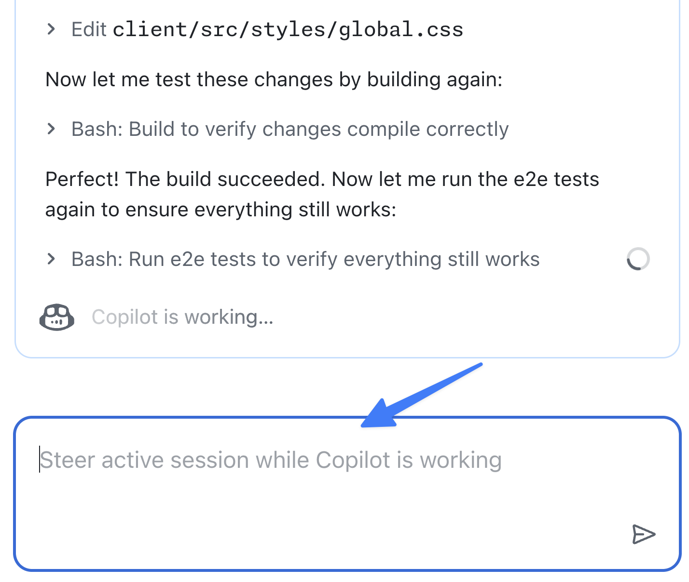

En los dos ejercicios anteriores has pedido al agente en la nube de Copilot que realice tres tareas distintas para mejorar la experiencia de usuario y añadir funcionalidad. Aunque el agente en la nube está diseñado para trabajar de forma autónoma y asíncrona, sigue siendo importante poder supervisar esas tareas.

Dispones de varias herramientas para gestionar las tareas asignadas al agente en la nube, como la [página de agentes][agents-page] de GitHub.com. Desde este centro de control puedes ver todas las tareas de agentes que tienen solicitudes de incorporación de cambios abiertas. También puedes explorar las operaciones realizadas e incluso dirigir una sesión en curso para ayudar a orientarla.

En esta lección:

- explorarás la página de agentes para supervisar las tareas del agente en la nube;
- dirigirás una sesión en curso para solicitar funcionalidad adicional.

## Escenario

Después de asignar al agente la creación de un modo de alto contraste, el equipo se dio cuenta de que también sería un buen momento para añadir un modo claro. Como ya se estaba actualizando el estilo del sitio y añadiendo controles de cambio de modo, tenía sentido incluir esta funcionalidad. Quieres orientar el trabajo del agente para que añada tanto el modo claro como el de alto contraste.

## Revisa las tareas del agente en la nube de Copilot

Veamos el estado actual de todas las tareas asignadas al agente en la nube de Copilot.

1. Ve a la [página de agentes de Copilot](https://github.com/copilot/agents).
2. Observa la lista de tareas en el panel principal y en el panel de la izquierda. Deberías ver las tareas que has asignado a Copilot, entre ellas:
   - actualizar la documentación de la base de código;
   - generar API para modificar juegos;
   - añadir un modo de alto contraste al sitio web.
3. Selecciona una de las tareas en curso. Revisa las operaciones realizadas por Copilot, que pueden incluir:
   - obtener el código del repositorio;
   - crear el entorno de trabajo de Copilot;
   - configurar servidores MCP;
   - realizar distintos pasos para completar la tarea asignada.

> [!NOTE]
> Los pasos exactos de la lista dependerán del estado del trabajo de Copilot y del enfoque que haya seguido.

4. Fíjate también en el panel de solicitudes de incorporación de cambios que aparece a la derecha. Te permite ver la solicitud y los archivos modificados para supervisar el trabajo.

## Dirige al agente en la nube

Ahora que has visto las tareas activas, pidamos a Copilot que añada el control del modo claro mientras trabaja en el modo de alto contraste.

1. Selecciona la sesión correspondiente a la creación del modo de alto contraste. El título exacto depende del nombre que haya elegido Copilot y del estado del trabajo.

    

2. Observa la sesión durante unos minutos, hasta que indique que ha terminado de configurar el entorno y ha empezado a trabajar. Lo sabrás cuando empiecen a aparecer mensajes similares a los siguientes.
3. En el cuadro de diálogo **Steer active session while Copilot is working**, escribe este prompt:

    ```plaintext
    Ya que estamos trabajando en un modo de alto contraste, añadamos también un modo claro. Debe haber también un control para este modo que permita a las personas elegir el modo de visualización que prefieran.
    ```

    

4. Pulsa <kbd>Enter</kbd> para enviar el prompt.
5. Observa cómo Copilot confirma que lo ha recibido y lo incorpora a su flujo de trabajo.

## Deja que Copilot trabaje

Como antes, ¡Copilot se pondrá a trabajar en la tarea actualizada! Incorporará la solicitud nueva a su flujo de trabajo cuando termine el paso que estaba realizando al recibir el mensaje.

Como este proceso tardará varios minutos, es un buen momento para hacer una pausa y repasar todo lo que has aprendido y explorado hasta ahora.

## Resumen y siguientes pasos

En esta lección has explorado la página de agentes de Copilot, el centro de control para supervisar y orientar las tareas del agente en la nube de GitHub Copilot. Desde aquí puedes hacer un seguimiento de las tareas activas y completadas, revisar el trabajo realizado y redirigir tareas en curso para ajustar su alcance o proporcionar orientación adicional.

Has explorado estos conceptos:

- has utilizado el centro de control y la página de agentes para supervisar las tareas del agente en la nube;
- has redirigido una sesión en curso para solicitar funcionalidad adicional.

Mientras Copilot completa el trabajo sobre las funciones de accesibilidad, pasaremos a [iterar sobre las solicitudes de incorporación de cambios que ha creado][next-lesson].

## Recursos

- [Página de agentes de Copilot][agents-page]
- [Información sobre agentes personalizados][custom-agents]

---

| [← Lección anterior: Agentes personalizados][previous-lesson] | [Siguiente lección: Iteración sobre el trabajo de Copilot →][next-lesson] |
|:--|--:|

[previous-lesson]: ../3-custom-agents/
[next-lesson]: ../5-iterating/
[agents-page]: https://github.blog/changelog/2025-07-03-agents-page-for-copilot-coding-agent-in-public-preview
[custom-agents]: https://docs.github.com/copilot/concepts/agents/cloud-agent/about-custom-agents
